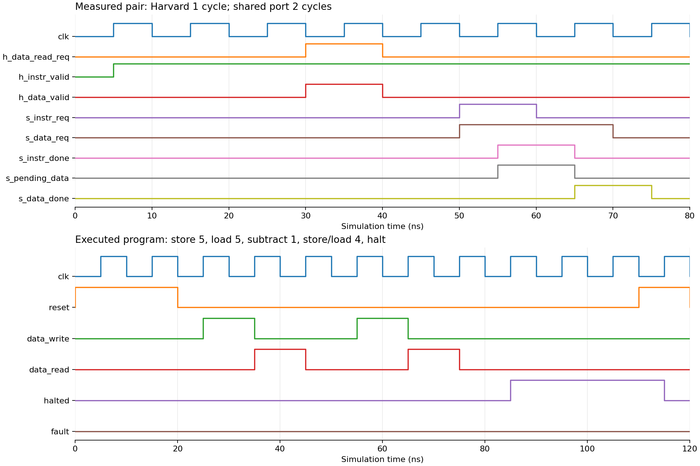
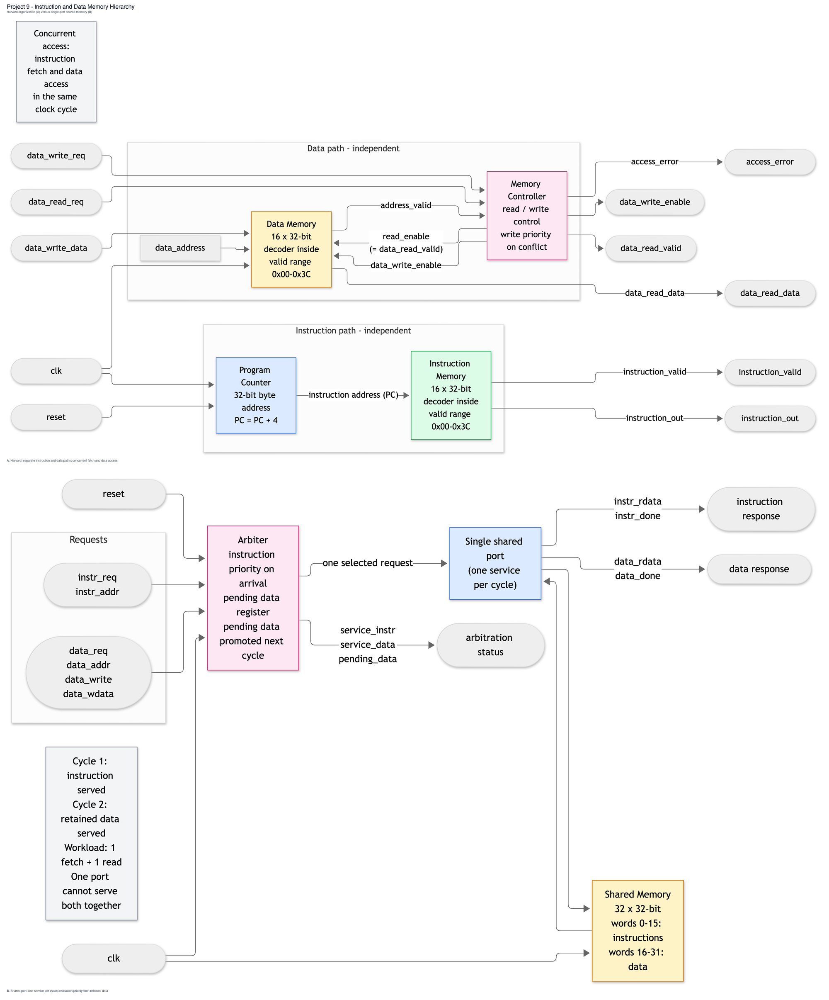

# Instruction and Data Memory Organization

Simplified Harvard RTL with independent instruction/data paths, an executable
teaching controller, and a single-port shared-memory baseline. Verified on
2026-11-11 with Icarus Verilog 13.0 and Yosys 0.70+post.

Video Link : https://drive.google.com/drive/folders/1isoOIEW29yKrh1GR4PTo7yXNPPL1AZCH?usp=sharing

| Verified result | Value |
|---|---:|
| Self-checking testbenches | 8 / 8 PASS |
| Directed and scoreboard checks | 1015 |
| Executed demo | 7 instructions in 7 cycles; 4 data accesses; x3 = 4 |
| Concurrent instruction fetch + data read | Harvard: 1 cycle; shared: 2 cycles |
| Throughput for that two-operation workload | Harvard: 2; shared: 1 operation/cycle |
| Storage in each memory-organization baseline | 1024 bits |
| RTL read ports | Harvard: 2 independent; shared: 1 multiplexed |
| Synthesis checks | 6 / 6 PASS; zero structural problems |

The measured 2x ratio applies to the simultaneous two-operation workload. It is
not a general CPU speedup or a frequency measurement.

## Project report

The IEEE-format report includes the abstract, literature review, proposed
solution, results and discussion, individual contributions, conclusion, and
references, with block diagrams and simulation evidence.

- [Project report (PDF)](reports/Harvard_Memory_IEEE_Report.pdf)
- [Editable LaTeX source](reports/Harvard_Memory_IEEE_Report.tex)

## Run

Requires Bash, Python 3 (standard library), Icarus Verilog / `vvp`, and Yosys.
No board is required.

```sh
make test                 # simulation + VCD assertions
make synthesis            # baseline + demo synthesis; resource report
./scripts/run_all.sh       # runs both stages even if one fails
```

Optional plotted timing evidence requires matplotlib:

```sh
python3 scripts/plot_waveforms.py
```



Raw VCDs are in `results/waveforms/` and can be opened in GTKWave or a VCD viewer.
The plot above was rendered from those files and visually checked. The regression
also checks actual signal values and service timing through `verify_waveforms.py`.

## Architecture and deliverables



| Deliverable | Files |
|---|---|
| Harvard memory RTL | `rtl/harvard_memory_system.v`, `instruction_fetch.v`, `program_counter.v`, `instruction_memory.v`, `data_memory.v`, `address_decoder.v`, `memory_controller.v` |
| Executable controller | `rtl/harvard_demo.v` |
| Shared-memory baseline | `rtl/shared_port_memory.v` |
| Block diagrams | `diagrams/*.png`; editable `diagrams/*.mmd` |
| Simulation and waveform evidence | `results/simulation/`, `results/waveforms/` |
| Measured comparison | `results/performance/performance_summary.txt` |
| Synthesis resources | `results/synthesis/comparison_table.md`, `summary.txt`, and six logs |
| IEEE-format project report | [PDF](reports/Harvard_Memory_IEEE_Report.pdf); [LaTeX source](reports/Harvard_Memory_IEEE_Report.tex)|

The baseline Harvard top continuously fetches a 16-word instruction ROM. Its
independent 16-word RAM accepts byte addresses `0x00..0x3C`, aligned to four bytes.
The controller rejects invalid data addresses and gives writes priority over
simultaneous reads. Reads are combinational; writes commit at a rising edge.
Reset restarts the baseline PC and preserves RAM. Baseline data requests remain
active during reset; the requester must drive them idle if it wants no writes.

The shared baseline stores instructions at `0x00..0x3C` and data at `0x40..0x7C`
in one 32-word array. An address mux precedes its **one read port**. Instructions
win initial contention; a captured data request wins the next cycle. Responses
are registered. Hold a valid request until `done`, then deassert it by the next
rising edge. The response cycle is a turnaround cycle for that requester. Invalid
shared addresses are not acknowledged; a requester must validate or time out.
Reset suppresses service and discards pending requests without clearing storage.

## Executed program

`harvard_demo` selects the ROM's `DEMO_PROGRAM=1` contents. Default ROM contents
remain unchanged for the original memory tests. The demo supports only ADDI,
32-bit LW/SW, and exact EBREAK, with no branches or pipeline. It stops on invalid
instructions, instruction addresses, or data accesses. It holds x0 at zero,
sign-extends immediates, and gates data requests during reset, halt, and fault.

```asm
addi x1, x0, 5
sw   x1, 0(x0)
lw   x2, 0(x0)
addi x2, x2, -1
sw   x2, 60(x0)
lw   x3, 60(x0)
ebreak
```

Verified final state: x1=5, x2=4, x3=4, RAM[0]=5, RAM[15]=4,
PC=24, retired=7, halted=1, fault=0. Each load/store overlaps the independent
fetch path. The shared comparison uses a separate simultaneous fetch/read
workload; the seven-instruction demo is executed on Harvard only.

## Group members and individual contributions

| Group member | Student ID | Contribution |
|---|---|---|
| Shagun Singh | 2401010434 | Harvard memory RTL: program counter, instruction memory, instruction-fetch path, and top-level connections. |
| Yogesh Mishra | 2401010518 | Data memory and control: data RAM, address decoding, read/write control, alignment checks, and invalid-access handling. |
| Shiva Sharma | 2401010441 | Shared-memory implementation: single-port memory, arbitration, pending-request retention, and completion handshake. |
| Pratyaksha Shastri | 2401010348 | Executable controller and verification: demo program, controller, testbenches, simulation, and waveform analysis. |
| Saksham Miglani | 2401010401 | Documentation and analysis: architecture comparison, synthesis and performance analysis, block diagrams, project report, video script, and presentation. |

See [architecture](docs/architecture.md), [timing](docs/microarchitecture.md),
[tests](docs/testing.md), [performance and synthesis](docs/performance_and_synthesis.md).

Memory power-up initialization is modeled with Verilog `initial` blocks. Generic
synthesis succeeds, but ASIC initialization, FPGA block-RAM inference, physical
area, power, and maximum clock frequency require a target-specific flow.
