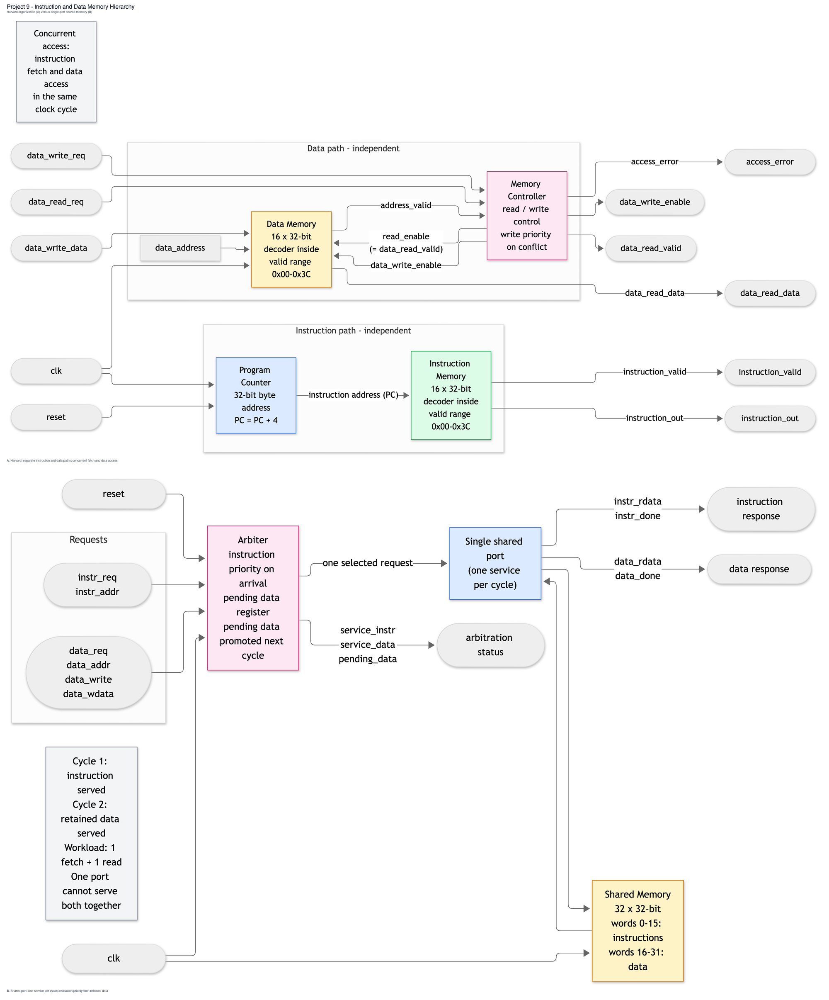
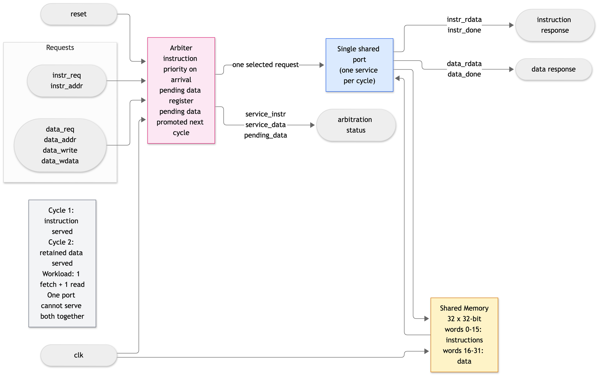

# Architecture

## 1. Objective

This project implements a small **Harvard-style memory system** and a **single-port
shared-memory baseline** so that the two organizations can be compared with the
same workload. It demonstrates instruction fetching, data reads, data writes,
address decoding, read/write control, simultaneous access, and bus contention.
A separate `harvard_demo` controller executes a seven-instruction ADDI/LW/SW/EBREAK program; no CPU pipeline is implemented.



Editable sources:

- `diagrams/harvard_architecture.mmd`
- `diagrams/shared_memory_architecture.mmd`

## 2. Harvard versus Von Neumann

A **Von Neumann** organization uses one memory system for both instructions and
data. If that memory has a single access port, an instruction fetch and a data
access must take turns. A **Harvard** organization provides separate instruction
and data memories, so the two accesses can use independent address and data
paths in the same clock cycle.

The shared-memory baseline in this project is a simplified illustration of the
Von Neumann contention problem. It is not a complete Von Neumann processor.
Real processors often use a modified Harvard arrangement (separate instruction
and data caches backed by a shared lower memory); caches and coherence are
outside this project's scope.

## 3. Implemented modules

| File | Module | Purpose |
|---|---|---|
| `rtl/program_counter.v` | `program_counter` | 32-bit byte PC; synchronous reset to 0; increments by 4 |
| `rtl/address_decoder.v` | `address_decoder` | Checks alignment/range and extracts a 4-bit word index for a 16-word memory |
| `rtl/instruction_memory.v` | `instruction_memory` | 16 x 32-bit initialized instruction memory, combinational read |
| `rtl/instruction_fetch.v` | `instruction_fetch` | Connects the PC to the instruction memory |
| `rtl/data_memory.v` | `data_memory` | 16 x 32-bit data memory, combinational read, synchronous write |
| `rtl/memory_controller.v` | `memory_controller` | Data read/write control with a documented write-priority policy |
| `rtl/harvard_memory_system.v` | `harvard_memory_system` | Harvard top level with separate instruction and data paths |
| `rtl/harvard_demo.v` | `harvard_demo` | Executable straight-line ADDI/LW/SW/EBREAK controller with its own PC/registers |
| `rtl/shared_port_memory.v` | `shared_port_memory` | 32 x 32-bit single-port memory with instruction-priority arbitration |

## 4. Harvard memory map and address decoding

### Instruction memory

- Size: 16 words x 32 bits = 512 bits.
- Byte addresses: `0x00000000` to `0x0000003C`.
- Word index: `address[5:2]`.
- Address `0x00` selects word 0, `0x04` word 1, ..., `0x3C` word 15.
- Reads are combinational.
- `instruction_valid` is high only for an aligned address in range.
- Invalid or unaligned addresses return `0x00000000` and `instruction_valid = 0`.

Default instruction patterns (the demo selects a separate executable program):

| Word | Byte address | Value |
|---:|---:|---|
| 0 | 0x00 | `0x00000013` |
| 1 | 0x04 | `0x00100093` |
| 2 | 0x08 | `0x00200113` |
| ... | ... | ... |
| 15 | 0x3C | `0x00F00793` |

### Data memory

- Size: 16 words x 32 bits = 512 bits.
- Byte addresses: `0x00000000` to `0x0000003C`.
- Word index: `address[5:2]`.
- Reads are combinational and gated by `read_enable`.
- Writes occur on the rising clock edge when `write_enable` and the address is valid.
- Initial values are `0x00000011`, `0x00000022`, ..., with word 15 = `0x00000456`.

### Decoder equations

```text
aligned   = (byte_address[1:0] == 2'b00)
in_range  = (byte_address[31:6] == 0)
valid     = aligned && in_range
word_index = byte_address[5:2]
```

The same decoder is instantiated inside `instruction_memory` and `data_memory`.
That is why the top-level data path does not need a separate external decoder:
the data memory exposes `valid`, which the controller uses to reject bad addresses.

## 5. Harvard data paths

### Instruction path

```text
reset -> program_counter -> PC (byte address) -> instruction_memory
      -> instruction_out / instruction_valid
```

The PC is 32 bits wide and advances by four bytes on every rising edge when reset
is low. Instruction fetching is therefore independent of the data address and
data control signals.

### Data path

```text
data_address --> data_memory address decoder --> word index / valid
data_read_req, data_write_req, valid --> memory_controller
memory_controller --> read_enable / write_enable / access_error
data_write_data --> data_memory
data_memory --> data_read_data
```

The data address is an input to the top level; it is not derived from the PC.
That is what makes a simultaneous instruction fetch and data access possible.

### Read/write controller truth table

| `read_request` | `write_request` | `address_valid` | `read_enable` | `write_enable` | `access_error` |
|---:|---:|---:|---:|---:|---:|
| 0 | 0 | x | 0 | 0 | 0 |
| 1 | 0 | 0 | 0 | 0 | 1 |
| 0 | 1 | 0 | 0 | 0 | 1 |
| 1 | 1 | 0 | 0 | 0 | 1 |
| 1 | 0 | 1 | 1 | 0 | 0 |
| 0 | 1 | 1 | 0 | 1 | 0 |
| 1 | 1 | 1 | 0 | 1 | 0 |

A simultaneous valid read and write is resolved deterministically by **write
priority**. The read is rejected (`data_read_valid = 0`); the write happens at
the next rising edge. A test verifies this policy and reads the new value back.

## 6. Shared-memory map and arbitration



### Memory map

The shared array has 32 words of 32 bits (1024 bits):

| Word range | Use | Byte addresses |
|---|---|---|
| 0-15 | instruction words | `0x00`-`0x3C` |
| 16-31 | data words | `0x40`-`0x7C` |

Instruction decoding uses the same rule as the Harvard instruction memory:
`instr_addr[31:6] == 0`, `instr_addr[1:0] == 00`, word index `instr_addr[5:2]`.

Data decoding requires the data-region base bit:

```text
data_addr_valid = (data_addr[31:7] == 0) && (data_addr[6] == 1) &&
                  (data_addr[1:0] == 00)
data_word = {1'b1, data_addr[5:2]}   // words 16..31
```

Examples: `0x40 -> word 16`, `0x44 -> word 17`, `0x7C -> word 31`.

### Arbitration policy

Only one request can use the array per clock cycle.

1. A new instruction request has priority.
2. If data is requested in the same cycle, the data address, write flag, and
   write data are captured in pending registers.
3. On the next cycle, the pending data request is promoted and served, even if
   the instruction request is still asserted.
4. A data request is therefore not lost and cannot be permanently starved under
   the documented single-request handshake.
5. `instr_done` and `data_done` are one-cycle completion pulses. The corresponding
   read data is registered and valid in the cycle where `done` is high.

Handshake: assert a request with a stable address; hold it until the matching
`done` pulse is observed; then deassert it by the following rising edge. A requester is blocked during its done cycle to prevent replay. Invalid addresses are not acknowledged; validate or time out. The testbenches follow this protocol.

## 7. Timing model

This project models a simple synchronous digital memory system, not a particular
SRAM macro or FPGA block RAM:

- Harvard instruction and data reads are **combinational**; `valid` is asserted
  in the same cycle as the address/request.
- Data writes are **synchronous** on the rising edge.
- The shared memory has registered read data and registered completion pulses,
  because one port must be arbitrated and results captured.
- Memory contents are initialized at time zero with `initial` blocks. The system
  reset resets the PC and the shared-memory arbitration state; it does **not**
  clear memory contents.
- No setup/hold times, clock-to-output delays, cache behavior, or physical memory
  latency are modeled.

The combinational read is deliberately simple for a beginner project. It should
not be described as a synchronous physical SRAM.

## 8. What is not modeled

- No complete CPU; the demo decodes ADDI/LW/SW/EBREAK only.
- No caches or cache coherence.
- No pipelining or hazard handling.
- No virtual memory or operating system.
- No complex bus protocol.
- No physical FPGA/ASIC timing model in the open-source synthesis flow used here.

The project demonstrates memory organization, access behavior, and a small executable controller. See `verification_review.md`.

The optional demo controller block diagram is `diagrams/demo_controller.mmd`.
